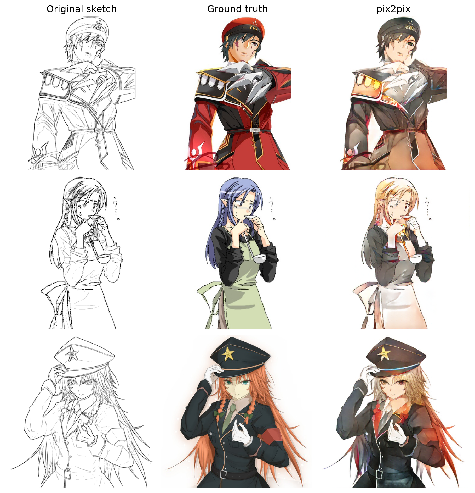
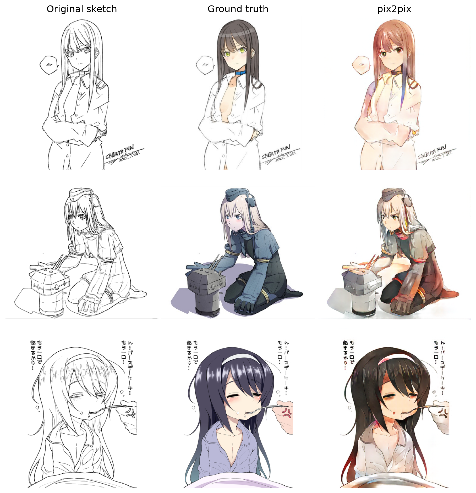

# pix2pix-sketch-colorization

Automatic colorization of anime line-art sketches with pix2pix (Isola et al., 2017). The model takes only the sketch as input (no color hints) and outputs a 512x512 RGB image. Includes the Kaggle training code and a local Gradio web app.

## Training on Kaggle

1. Open the [dataset page](https://www.kaggle.com/datasets/ktaebum/anime-sketch-colorization-pair) and click *New Notebook* (the dataset is attached automatically).
2. *File -> Import Notebook* and select [`train/pix2pix_kaggle.ipynb`](train/pix2pix_kaggle.ipynb). The notebook already contains `train.py`.
3. In the right panel set *Accelerator = GPU T4* and *Internet = On* (needed for `clean-fid` and the VGG-19 weights).
4. Check the settings cell (`EPOCHS = 25`, `BATCH = 4`, `MAX_HOURS = 10.5`).
5. *Save Version -> Save & Run All (Commit)*. You can close the browser; the run continues in the background (about 9.5 h on a T4: smoke test, benchmark, training, test evaluation).
6. When the version has finished, open its *Output* tab and download `generator.pth` to `weights/generator.pth`.

| Output file | Use |
|---|---|
| `generator.pth` | the only file the web app needs |
| `results.zip` | metrics.json, split.json, losses.csv, val_log.csv, sample and loss-curve images |
| `checkpoints/` | best.pt, last.pt and periodic checkpoints (only for resuming or re-evaluation) |

> [!NOTE]
> Kaggle sometimes saves `generator.pth` as `generator.zip`, because a PyTorch checkpoint is a zip archive internally. Do not extract it; rename it to `generator.pth`. If the zip contains a `generator.pth` file instead, extract that file.

If a run hits the time limit, add its output as an input to a new notebook and set `RESUME = "/kaggle/input/<output>/checkpoints/last.pt"`. The script can also be called directly:

```bash
python train/train.py --mode smoke      # end-to-end check on a small subset
python train/train.py --mode benchmark  # epoch time and memory
python train/train.py --mode train      # batch 4, 25 epochs, resumable
python train/train.py --mode evaluate   # test metrics from a checkpoint
```

`train/build_notebook.py` regenerates the notebook after editing `train.py`.

## Pretrained weights

Instead of training, download the trained generator (218 MB) from the [latest release](https://github.com/zyr1on/pix2pix-sketch-colorization/releases/latest) and save it as `weights/generator.pth`:

```bash
curl -L -o weights/generator.pth https://github.com/zyr1on/pix2pix-sketch-colorization/releases/latest/download/generator.pth
```

## Running the web app

```bash
pip install -r requirements.txt   # install PyTorch with CUDA separately
python app/app.py                 # uses weights/generator.pth, opens http://127.0.0.1:7860
python app/app.py --model path/to/generator.pth --port 7861 --no_browser
```

Upload a plain sketch or a dataset pair (left color, right sketch). The output is shown on the right, and the sketch / ground truth / output under "Details".

## Results

Test split, 1,777 pairs, best checkpoint (epoch 16). Source: [`results/metrics.json`](results/metrics.json), [`results/latency.json`](results/latency.json).

| Metric | Value |
|---|---|
| SSIM (RGB, [0, 1]) | 0.854 ± 0.059 |
| FID (clean-fid, 1,777 vs 1,777) | 29.23 |
| Edge F1 (Canny 100/200, ±2 px) | 0.962 ± 0.021 (ground truth: 0.956) |
| L1 ([-1, 1] scale) | 0.121 ± 0.058 |
| Inference, RTX 4050 Laptop, fp16, batch 1 | 8.05 ± 0.35 ms per image (forward only 7.20 ms) |

Edge F1 compares the Canny edges of the sketch with those of the output; the same measure applied to the ground-truth image is given for reference.




Sketches come from the test split and were not seen during training or model selection. With the sketch as the only input, colors are often plausible but differ from the ground truth.

## Training details

| | |
|---|---|
| Data | [Anime Sketch Colorization Pair](https://www.kaggle.com/datasets/ktaebum/anime-sketch-colorization-pair), each image = color (left) + sketch (right) |
| Split | train/ and val/ merged (17,769 pairs), shuffled with seed 42, 80/10/10 -> 14,215 / 1,777 / 1,777 |
| Input / output | 1-channel sketch, 512x512, [-1, 1] -> 3-channel RGB, Tanh |
| Augmentation | joint horizontal flip (p = 0.5), sketch-only line thickening by erosion (p = 0.3, 2-3 px), no random crop |
| Generator | 8-level U-Net, skip connections, dropout 0.5 in the first 3 decoder layers, no BN at the bottleneck |
| Discriminator | 70x70 PatchGAN on sketch + image (62x62 patch outputs for a 512x512 input) |
| Loss | cGAN (non-saturating, D loss halved) + 100 · L1 + 10 · VGG-19 `relu4_4` perceptual loss |
| Optimizer | Adam, lr 2e-4, betas (0.5, 0.999), N(0, 0.02) init, AMP fp16 |
| Batch / epochs | 4 / 25 (best epoch 16, lowest validation L1 on 500 images) |
| Hardware / time | Kaggle, Tesla T4, 8.75 h of training in one session |

At test time dropout stays on and BatchNorm uses the statistics of the current image, as in the paper. This was chosen over `model.eval()` by validation L1 (0.1175 vs 0.1226).

Per-epoch validation used `model.eval()`, whose BatchNorm running statistics fluctuate during GAN training, so validation L1 varied strongly between epochs while the training loss decreased steadily.

Scripts (folder of dataset pairs; results go to `results/latency.json` and `assets/samples_*.png`):

```bash
python scripts/benchmark_latency.py --input <folder> [--weights path/to/generator.pth]
python scripts/make_figure.py --input <folder> [--weights path/to/generator.pth] [--test_only 1]
```

> [!NOTE]
> The dataset's own `val/` folder is not the test set here: train/ and val/ were merged and re-split, so most `val/` images are in the training split. `make_figure.py` warns about images that are not in the test split of `results/split.json` (`--test_only 1` skips them). Use test-split images for reported figures.

## Layout

```
train/     train.py, pix2pix_kaggle.ipynb, build_notebook.py
app/       app.py (Gradio), model.py (inference wrapper)
scripts/   benchmark_latency.py, make_figure.py
results/   metrics.json, latency.json, split.json
assets/    sample figures
weights/   generator.pth (not tracked; see Pretrained weights)
```

## Reference

P. Isola, J.-Y. Zhu, T. Zhou, A. A. Efros. Image-to-Image Translation with Conditional Adversarial Networks. CVPR 2017.
